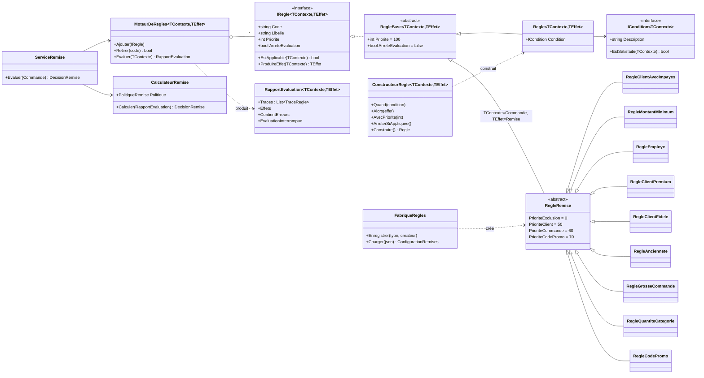
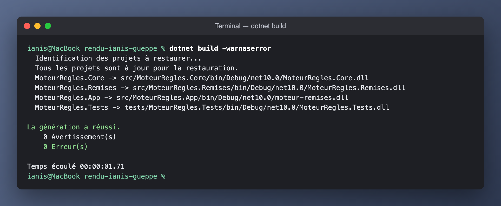
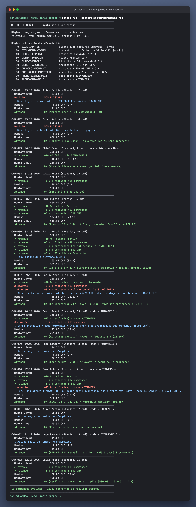
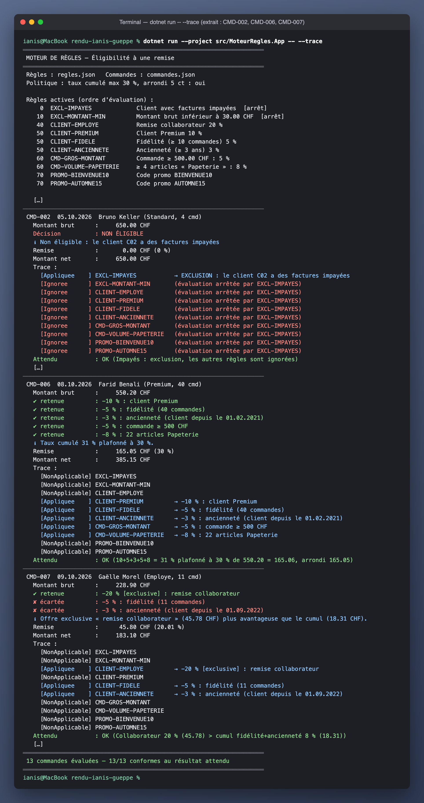
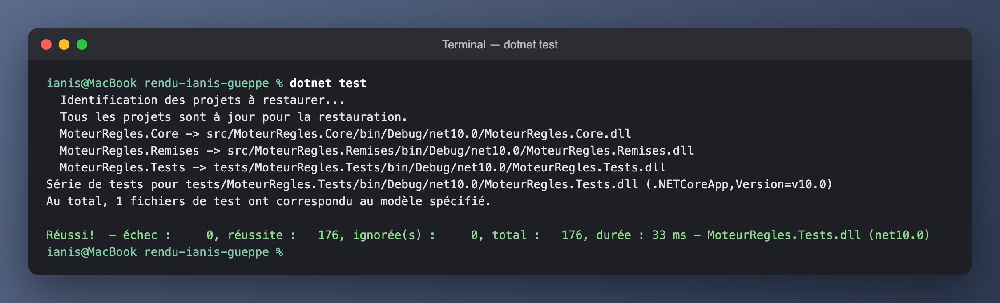
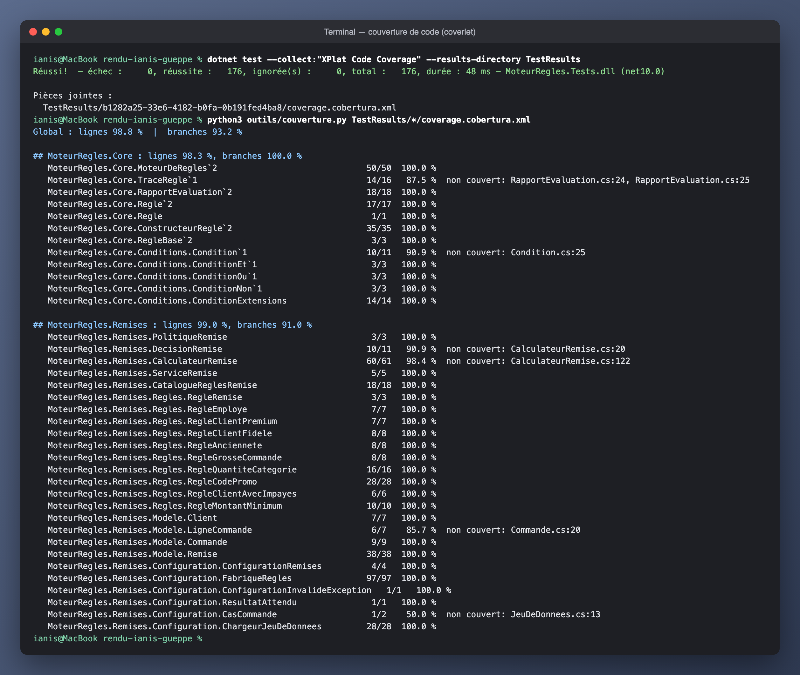
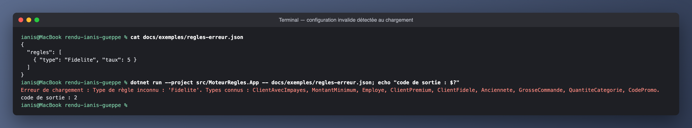
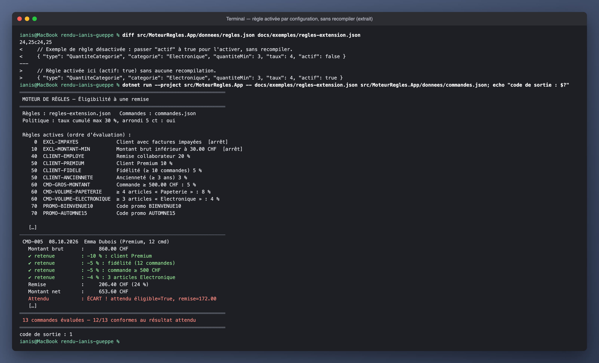

# Rapport — Projet 5 : Moteur de règles simple pour un cas métier

| | |
|---|---|
| **Étudiant** | Ianis Gueppe |
| **Classe** | E1B |
| **Cours** | 05 — Algorithmique orientée C# (CFC 319 — Concevoir et implémenter des applications) |
| **Formateur référent** | Morrad |
| **Semaine PPE** | 5 – 9 octobre 2026 · rendu le 12 octobre 2026 |
| **Technologies** | C# 14 · .NET 10 · xUnit · coverlet |

---

## Sommaire

1. [Résumé](#1-résumé)
2. [Cas métier retenu](#2-cas-métier-retenu-étape-1)
3. [Conception de la structure de règles](#3-conception-de-la-structure-de-règles-étape-2)
4. [Implémentation du moteur](#4-implémentation-du-moteur-étape-3)
5. [Tests et jeux de données](#5-tests-et-jeux-de-données-étape-4)
6. [Extensibilité](#6-extensibilité-étape-5)
7. [Utilisation](#7-utilisation)
8. [Limites et améliorations possibles](#8-limites-et-améliorations-possibles)
9. [Correspondance avec la grille d'évaluation](#9-correspondance-avec-la-grille-dévaluation)
10. [Arborescence du rendu](#10-arborescence-du-rendu)
11. [Sources](#11-sources)

---

## 1. Résumé

Ce projet calcule les remises sur les commandes d'une boutique en ligne de fournitures de bureau. Le but est de pouvoir changer les offres commerciales sans réécrire le moteur de calcul.

Le projet est réparti en trois parties :

- `MoteurRegles.Core` évalue les règles dans l'ordre de priorité et garde une trace de chaque résultat. Il gère aussi l'arrêt de l'évaluation et les erreurs.
- `MoteurRegles.Remises` contient les 9 types de règles et le calcul des remises : cumul, plafond, offres exclusives et arrondi aux 5 centimes. Les paramètres se chargent depuis un fichier JSON.
- L'application console exécute 13 commandes et compare les résultats aux valeurs attendues. Les 13 résultats sont conformes.

Les 176 tests xUnit passent. La couverture mesurée est de 98,8 % des lignes et de 93,2 % des branches. Les tests vérifient aussi les trois façons d'ajouter une règle : par configuration JSON, avec une règle fluente ou avec une nouvelle classe.

---

## 2. Cas métier retenu (étape 1)

Le cas retenu est l'éligibilité d'une commande à une remise. Une boutique en ligne applique plusieurs offres selon le profil du client, le contenu de la commande et les codes promotionnels. Comme ces offres changent au fil des campagnes, leurs paramètres doivent pouvoir être modifiés sans redévelopper l'application.

### 2.1 Règles métier

| # | Code | Règle | Effet | Type |
|---|---|---|---|---|
| 1 | `EXCL-IMPAYES` | Le client a des factures impayées | Aucune remise, **arrêt** de l'évaluation | Exclusion |
| 2 | `EXCL-MONTANT-MIN` | Montant brut < 30 CHF | Aucune remise, **arrêt** | Exclusion |
| 3 | `CLIENT-EMPLOYE` | Le client est un collaborateur | −20 % | **Exclusive** |
| 4 | `CLIENT-PREMIUM` | Le client est Premium | −10 % | Cumulable |
| 5 | `CLIENT-FIDELE` | ≥ 10 commandes passées | −5 % | Cumulable |
| 6 | `CLIENT-ANCIENNETE` | Inscrit depuis ≥ 3 ans à la date de la commande | −3 % | Cumulable |
| 7 | `CMD-GROS-MONTANT` | Montant brut ≥ 500 CHF | −5 % | Cumulable |
| 8 | `CMD-VOLUME-PAPETERIE` | ≥ 4 articles de la catégorie « Papeterie » | −8 % | Cumulable |
| 9 | `PROMO-BIENVENUE10` | Code `BIENVENUE10`, 1re commande uniquement | −10 CHF | Cumulable |
| 10 | `PROMO-AUTOMNE15` | Code `AUTOMNE15`, du 22.09 au 20.12.2026 | −15 % | **Exclusive** |

### 2.2 Politique commerciale (calcul de la décision finale)

1. **Une seule exclusion** suffit : la commande n'est pas éligible.
2. Les remises **cumulables** s'additionnent ; le total des pourcentages est **plafonné à 30 %**, puis on ajoute les montants fixes.
3. La meilleure remise **exclusive** est comparée à ce cumul : on retient **la plus avantageuse pour le client** (en cas d'égalité, le cumul).
4. La remise ne dépasse jamais le montant brut et est **arrondie aux 5 centimes** (usage suisse).

Ces paramètres (plafond, arrondi) sont configurables.

---

## 3. Conception de la structure de règles (étape 2)

### 3.1 Architecture en couches

```
┌──────────────────────────┐   ┌───────────────────────────┐
│ MoteurRegles.App         │   │ MoteurRegles.Tests        │
│ (console de démo)        │   │ (xUnit, 176 tests)        │
└────────────┬─────────────┘   └─────────────┬─────────────┘
             │                               │
             ▼                               ▼
┌──────────────────────────────────────────────────────────┐
│ MoteurRegles.Remises — DOMAINE                           │
│ Commande, Client, Remise · 9 règles · CalculateurRemise  │
│ ServiceRemise · FabriqueRegles (JSON)                    │
└────────────────────────────┬─────────────────────────────┘
                             │ dépend uniquement de
                             ▼
┌──────────────────────────────────────────────────────────┐
│ MoteurRegles.Core — MOTEUR GÉNÉRIQUE (aucun métier)      │
│ IRegle<TCtx,TEff> · MoteurDeRegles · ICondition · Regle  │
└──────────────────────────────────────────────────────────┘
```

Le moteur ne référence pas le projet de remises. Il peut donc servir à un autre besoin. Un test utilise par exemple `MoteurDeRegles<Commande, string>` pour valider une commande et renvoyer des messages d'erreur.

### 3.2 Diagramme de classes



### 3.3 Choix de conception

| Choix | Justification |
|---|---|
| **Interface `IRegle<TContexte, TEffet>`** (« SI condition ALORS effet ») | Contrat minimal : le moteur manipule toutes les règles de la même manière (polymorphisme). |
| **Génériques** `TContexte` / `TEffet` | Le moteur est réutilisable pour d'autres cas métier, avec un typage fort (pas de `object`, pas de cast). |
| **Séparation règle / politique** | Chaque règle propose une remise. `CalculateurRemise` décide ensuite comment les combiner : cumul, plafond et exclusivité. Une nouvelle règle qui produit un de ces effets utilise le même calcul. |
| **Priorité + arrêt anticipé** | Les exclusions passent en premier et coupent l'évaluation : pas de calcul inutile, et des traces claires (« ignorée : évaluation arrêtée par EXCL-IMPAYES »). |
| **Trace de chaque règle** (`RapportEvaluation`) | Le rapport indique quelles règles ont été appliquées, ignorées ou écartées. Cela permet de retrouver l'origine d'une remise. |
| **Isolation des erreurs** | Une règle qui lève une exception est tracée `Erreur`. Elle ne fait pas planter l'évaluation de la commande. |
| **Date dans le contexte** | Les règles ne lisent jamais `DateTime.Now`, donc les résultats sont **déterministes et testables** (campagnes, ancienneté). |
| **`decimal`** pour les montants | Pas d'erreur d'arrondi binaire comme avec `double`, indispensable pour de l'argent. |
| **Records immuables** (`Commande`, `Client`, `Remise`, `DecisionRemise`) | Pas d'effet de bord entre règles, et l'égalité par valeur simplifie les tests. |
| **Validation à la construction** | Taux hors 0–100, seuil négatif, dates incohérentes : l'erreur apparaît au chargement de la configuration, pas pendant un calcul. |

### 3.4 Patrons de conception utilisés

| Patron | Où | Rôle |
|---|---|---|
| **Strategy** | `IRegle` et ses implémentations | Chaque règle est une stratégie interchangeable. |
| **Specification** | `ICondition`, `Et` / `Ou` / `Non` | Conditions métier nommées et composables, qui s'auto-décrivent. |
| **Builder** (API fluide) | `Regle.Creer(...).Quand(...).Alors(...)` | Créer une règle sans écrire de classe. |
| **Factory + Registry** | `FabriqueRegles` | Associe un nom de type JSON à une fonction de création ; on l'étend avec `Enregistrer`. |
| **Template Method** (léger) | `RegleBase` / `RegleRemise` | Valeurs par défaut et conventions communes. |
| **Façade** | `ServiceRemise` | Un seul appel `Evaluer(commande)` qui enchaîne moteur et calculateur. |

---

## 4. Implémentation du moteur (étape 3)

### 4.1 Algorithme d'évaluation

```
FONCTION Evaluer(contexte)
    traces ← liste vide
    arreteePar ← rien
    POUR CHAQUE regle DANS règles triées par priorité croissante (tri stable)
        SI arreteePar ≠ rien ALORS
            ajouter trace(regle, IGNORÉE, "arrêtée par " + arreteePar) ; CONTINUER
        ESSAYER
            SI regle.EstApplicable(contexte) ALORS
                effet ← regle.ProduireEffet(contexte)
                ajouter trace(regle, APPLIQUÉE, effet)
                SI regle.ArreteEvaluation ALORS arreteePar ← regle.Code
            SINON
                ajouter trace(regle, NON APPLICABLE)
        EN CAS D'EXCEPTION e
            ajouter trace(regle, ERREUR, e.Message)       // les autres règles continuent
    RETOURNER Rapport(contexte, traces)
```

Extrait de [MoteurDeRegles.cs](src/MoteurRegles.Core/MoteurDeRegles.cs) :

```csharp
foreach (var regle in Regles)                      // Regles = OrderBy(Priorite) : tri stable
{
    if (arreteePar is not null)
    {
        traces.Add(new TraceRegle<TEffet>(regle.Code, regle.Libelle, regle.Priorite,
            StatutRegle.Ignoree, Message: $"évaluation arrêtée par {arreteePar}"));
        continue;
    }

    traces.Add(EvaluerRegle(regle, contexte));     // try/catch à l'intérieur

    if (traces[^1].Statut == StatutRegle.Appliquee && regle.ArreteEvaluation)
        arreteePar = regle.Code;
}
```

**Complexité :** O(n log n) pour trier les n règles, puis O(n · c) pour les évaluer, où c représente le coût d'une condition. Une règle qui parcourt les articles dépend donc aussi du nombre de lignes de la commande. Le temps d'exécution n'a pas été mesuré séparément.

Le moteur vérifie aussi les points suivants :
- codes de règle **uniques** (insensible à la casse) : un doublon est refusé à l'ajout ;
- à priorité égale, **l'ordre d'ajout est conservé** (`OrderBy` est un tri stable, contrairement à `List.Sort`) ;
- le moteur est **réutilisable** : aucune donnée d'une évaluation ne reste pour la suivante.

### 4.2 Calcul de la décision ([CalculateurRemise.cs](src/MoteurRegles.Remises/CalculateurRemise.cs))

```
exclusions présentes ?            → NON ÉLIGIBLE, remise 0
cumul      = brut × min(Σ % cumulables, 30 %) + Σ montants fixes cumulables
exclusive  = max(montant de chaque remise exclusive)
remise     = exclusive > cumul ? exclusive : cumul
remise     = arrondi_5ct(min(remise, brut))
```

### 4.3 Exemple de trace produite (commande CMD-002, client avec impayés)

```
[Appliquee    ] EXCL-IMPAYES           → EXCLUSION : le client C02 a des factures impayées
[Ignoree      ] EXCL-MONTANT-MIN       (évaluation arrêtée par EXCL-IMPAYES)
[Ignoree      ] CLIENT-EMPLOYE         (évaluation arrêtée par EXCL-IMPAYES)
...
```

La sortie complète est dans [preuves/02-sortie-console-trace.txt](preuves/02-sortie-console-trace.txt).

---

## 5. Tests et jeux de données (étape 4)

### 5.1 Stratégie

| Niveau | Fichier(s) | Ce qui est vérifié |
|---|---|---|
| **Unitaire — moteur** | `Core/MoteurDeReglesTests`, `ConditionTests`, `RegleFluenteTests` | Ordre par priorité, tri stable, arrêt anticipé, isolation des exceptions, doublons, retrait, composition ET/OU/NON, builder. Le contexte est un simple `int` : le moteur est testé **sans le métier**. |
| **Unitaire — règles** | `Remises/ReglesTests`, `RemiseTests` | Chaque règle, **aux valeurs limites** : 29.95 / 30.00 CHF, 9 / 10 commandes, ancienneté le jour exact, bornes de campagne incluses, casse et espaces du code promo… |
| **Unitaire — politique** | `Remises/CalculateurRemiseTests` | Exclusion, cumul, plafond, exclusive contre cumul, égalité, remise > brut, arrondi 5 ct (dont le cas « milieu » 2.625 → 2.65). |
| **Configuration** | `Remises/ConfigurationTests` | Chargement JSON, valeurs par défaut, règles inactives, **8 configurations invalides** avec message explicite. |
| **Scénarios de bout en bout** | `Scenarios/JeuxDeDonneesTests` | Les 13 commandes de référence, avec le catalogue en code **et** avec la configuration JSON ; les deux catalogues sont identiques. |
| **Extensibilité / non-régression** | `Extensibilite/AjoutRegleTests` | Les 3 méthodes d'ajout ; l'ajout d'une règle ne change aucun résultat existant ; réutilisation du moteur pour un autre domaine. |

### 5.2 Jeu de données de référence ([commandes.json](src/MoteurRegles.App/donnees/commandes.json))

Chaque commande contient un résultat attendu dans le fichier JSON. L'application console et les tests utilisent ce même fichier pour vérifier les calculs.

| Commande | Client | Brut | Situation testée | Remise | Net |
|---|---|---:|---|---:|---:|
| CMD-001 | Standard | 21.00 | Montant < minimum → **exclusion** | 0.00 | 21.00 |
| CMD-002 | Impayés | 650.00 | **Exclusion + arrêt** (les autres règles sont ignorées) | 0.00 | 650.00 |
| CMD-003 | Nouveau | 120.00 | Code `bienvenue10` (casse ignorée), 1re commande | 10.00 | 110.00 |
| CMD-004 | Fidèle | 200.00 | Fidélité seule | 10.00 | 190.00 |
| CMD-005 | Premium fidèle | 860.00 | Cumul 10 + 5 + 5 % | 172.00 | 688.00 |
| CMD-006 | Premium ancien | 550.20 | 5 remises = 31 % → **plafond 30 %** + **arrondi** 165.06 → 165.05 | 165.05 | 385.15 |
| CMD-007 | Employé | 228.90 | **Exclusive** 20 % > cumul 8 % | 45.80 | 183.10 |
| CMD-008 | Fidèle | 300.00 | Code exclusif 15 % > fidélité 5 % | 45.00 | 255.00 |
| CMD-009 | Standard | 80.20 | Code `AUTOMNE15` **avant** le début de la campagne | 0.00 | 80.20 |
| CMD-010 | Premium fidèle | 700.00 | **Cumul** 20 % > code exclusif 15 % | 140.00 | 560.00 |
| CMD-011 | Standard | 95.50 | Code promo **inconnu** | 0.00 | 95.50 |
| CMD-012 | Standard | 45.00 | `BIENVENUE10` refusé (pas la 1re commande) | 0.00 | 45.00 |
| CMD-013 | Fidèle | 500.00 | Seuil gros montant atteint **pile** | 50.00 | 450.00 |

### 5.3 Résultats

| Indicateur | Valeur |
|---|---|
| Tests exécutés | **176** (Core 43 · Remises 90 · Scénarios 32 · Extensibilité 11) |
| Tests réussis | **176 / 176** |
| Couverture des lignes | **98,8 %** |
| Couverture des branches | **93,2 %** |
| Jeu de référence (console) | **13 / 13** commandes conformes |
| Avertissements de compilation | **0** (compilation avec `-warnaserror`, `Nullable` activé) |

Les sorties complètes sont conservées dans les fichiers suivants :
- [preuves/01-sortie-console.txt](preuves/01-sortie-console.txt) — exécution de l'application ;
- [preuves/02-sortie-console-trace.txt](preuves/02-sortie-console-trace.txt) — même exécution avec la trace règle par règle ;
- [preuves/03-resultats-tests.txt](preuves/03-resultats-tests.txt) — liste des 176 tests ;
- [preuves/04-couverture.txt](preuves/04-couverture.txt) — couverture par classe (+ `coverage.cobertura.xml` brut).

### 5.4 Captures d'écran

**Compilation sans avertissement** (option `-warnaserror`)



**Exécution de l'application sur les 13 commandes de référence : 13/13 conformes**



**Trace règle par règle** (extrait) : exclusion avec arrêt (CMD-002), plafond à 30 % (CMD-006), offre exclusive retenue (CMD-007)



**Tests automatisés : 176 réussis**



**Couverture de code**



**Configuration invalide détectée au chargement** (type de règle inconnu → message explicite, code de sortie 2)



La liste détaillée des 176 tests est dans [captures/05-tests-detail.png](captures/05-tests-detail.png). La démonstration d'extension sans recompilation est au § 6.

---

## 6. Extensibilité (étape 5)

Les exemples détaillés sont dans [docs/EXTENSIBILITE.md](docs/EXTENSIBILITE.md). Trois méthodes sont possibles :

| Méthode | Exemple | Recompiler ? |
|---|---|---|
| **A. JSON** | `{ "type": "CodePromo", "code": "NOEL20", "taux": 20, "cumulable": false, "debut": "2026-12-01", "fin": "2026-12-24" }` | **Non** |
| **B. Règle fluente** | `Regle.Creer<Commande, Remise>("CMD-PANIER-MIXTE", "…").Quand(…).Alors(…).Construire()` | Oui, sans nouvelle classe |
| **C. Nouvelle classe** | `class RegleBlackFriday : RegleRemise { … }` + `moteur.Ajouter(new RegleBlackFriday())` | Oui, une classe |

La classe `RegleBlackFriday` est définie dans le projet de tests. Son ajout ne modifie ni le moteur ni le projet de remises. Le test `Methode_1_ajouter_une_regle_ne_change_aucun_resultat_existant` rejoue les 13 commandes de référence et vérifie que leurs résultats restent les mêmes.

Pour tester l'ajout par JSON, le fichier [docs/exemples/regles-extension.json](docs/exemples/regles-extension.json) reprend `regles.json` avec une modification : la règle « ≥ 3 articles Electronique : 4 % » passe en `"actif": true`. En relançant l'application avec ce fichier, sans recompiler :
- la nouvelle règle `CMD-VOLUME-ELECTRONIQUE` apparaît dans la liste des règles actives ;
- elle s'applique à CMD-005 (1 écran + 2 câbles = 3 articles Electronique), dont la remise passe de 20 % à 24 %.

Le résultat attendu de CMD-005 reste celui du jeu de référence. L'application signale donc l'écart et renvoie le code 1. Ce test montre que la règle ajoutée est prise en compte.



---

## 7. Utilisation

Prérequis : [.NET SDK 10](https://dotnet.microsoft.com/download).

```bash
cd 05-algo-csharp-319/rendu-ianis-gueppe
```

Lancer la démonstration (règles et commandes par défaut) :

```bash
dotnet run --project src/MoteurRegles.App
```

Afficher en plus la trace de chaque règle :

```bash
dotnet run --project src/MoteurRegles.App -- --trace
```

Utiliser ses propres fichiers de règles et de commandes :

```bash
dotnet run --project src/MoteurRegles.App -- chemin/regles.json chemin/commandes.json
```

Lancer les tests :

```bash
dotnet test
```

Mesurer la couverture :

```bash
dotnet test --collect:"XPlat Code Coverage"
```

Codes de sortie de l'application : `0` = tout est conforme, `1` = au moins un écart avec le résultat attendu, `2` = fichier de configuration invalide.

---

## 8. Limites et améliorations possibles

| Limite actuelle | Amélioration envisageable |
|---|---|
| Une seule politique de combinaison (cumul plafonné contre meilleure exclusive) | Extraire une interface `IPolitiqueCombinaison` (première règle gagnante, somme, maximum…) choisie dans la configuration |
| Les conditions des règles JSON sont limitées aux types prévus | Un petit langage d'expressions (ex. `"condition": "client.categorie == 'Premium' && montant > 200"`) ou des expressions compilées (`System.Linq.Expressions`) |
| Règles et commandes stockées en fichiers JSON | Base de données + interface d'administration pour le service marketing |
| Évaluation séquentielle | Évaluation parallèle (`Parallel.ForEach`) pour de gros lots de commandes : le moteur s'y prête, il n'a pas d'état partagé |
| Pas de gestion du budget d'une campagne (nombre d'utilisations d'un code) | Ajouter un service de compteurs injecté dans la règle `CodePromo` |
| Remise calculée sur le montant global | Remises par ligne ou par catégorie de produits |

---

## 9. Correspondance avec la grille d'évaluation

| Critère (pondération) | Où le trouver |
|---|---|
| **Conception de la structure de règles (30 %)** | § 3 : interface générique `IRegle`, conditions composables, builder, fabrique, séparation règle / politique, patrons de conception, diagramme de classes |
| **Implémentation du moteur (30 %)** | § 4 : [MoteurDeRegles.cs](src/MoteurRegles.Core/MoteurDeRegles.cs) (priorité, tri stable, arrêt, isolation des erreurs, trace), [CalculateurRemise.cs](src/MoteurRegles.Remises/CalculateurRemise.cs), application console |
| **Couverture des tests (20 %)** | § 5 : 176 tests, 98,8 % de lignes / 93,2 % de branches, valeurs limites, 13 scénarios de bout en bout, tests de non-régression |
| **Documentation et extensibilité (20 %)** | § 6 et [docs/EXTENSIBILITE.md](docs/EXTENSIBILITE.md) : 3 méthodes d'ajout, conventions, vérifications à effectuer ; commentaires XML dans le code |

---

## 10. Arborescence du rendu

```
rendu-ianis-gueppe/
├── README.md                         ← ce rapport
├── MoteurRegles.slnx                 ← solution .NET
├── docs/
│   ├── EXTENSIBILITE.md              ← documentation d'extensibilité
│   └── exemples/                     ← configuration étendue et configuration invalide (démos)
├── captures/                         ← captures d'écran (compilation, exécution, tests, couverture…)
├── preuves/                          ← sorties console, résultats de tests, couverture (texte intégral)
├── outils/
│   └── couverture.py                 ← résumé de la couverture par classe
├── src/
│   ├── MoteurRegles.Core/            ← moteur générique (aucune dépendance métier)
│   │   ├── IRegle.cs · RegleBase.cs · Regle.cs (builder)
│   │   ├── MoteurDeRegles.cs · RapportEvaluation.cs
│   │   └── Conditions/ (ICondition, Condition, Et/Ou/Non)
│   ├── MoteurRegles.Remises/         ← cas métier « éligibilité à une remise »
│   │   ├── Modele/ (Commande, Client, LigneCommande, Remise)
│   │   ├── Regles/ (exclusions, profil client, contenu commande, codes promo)
│   │   ├── Configuration/ (FabriqueRegles, ChargeurJeuDeDonnees)
│   │   └── CalculateurRemise.cs · ServiceRemise.cs (+ catalogue par défaut)
│   └── MoteurRegles.App/             ← application console de démonstration
│       └── donnees/ (regles.json, commandes.json)
└── tests/
    └── MoteurRegles.Tests/           ← xUnit : Core/, Remises/, Scenarios/, Extensibilite/
```

---

## 11. Sources

- [Microsoft Learn — Interfaces en C#](https://learn.microsoft.com/fr-fr/dotnet/csharp/fundamentals/types/interfaces)
- [Microsoft Learn — Génériques en C#](https://learn.microsoft.com/fr-fr/dotnet/csharp/fundamentals/types/generics)
- [Microsoft Learn — Types record](https://learn.microsoft.com/fr-fr/dotnet/csharp/fundamentals/types/records)
- [Microsoft Learn — System.Text.Json](https://learn.microsoft.com/fr-fr/dotnet/standard/serialization/system-text-json/overview)
- [Microsoft Learn — Tests unitaires C# avec xUnit](https://learn.microsoft.com/fr-fr/dotnet/core/testing/unit-testing-csharp-with-xunit)
- [Microsoft Learn — Couverture du code pour les tests unitaires](https://learn.microsoft.com/fr-fr/dotnet/core/testing/unit-testing-code-coverage)
- Martin Fowler — *Rules Engine* et Eric Evans / Martin Fowler — *Specifications* (patron Specification)
- Robert C. Martin — principes SOLID (en particulier ouvert/fermé)
